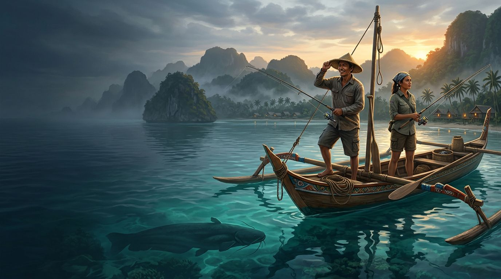
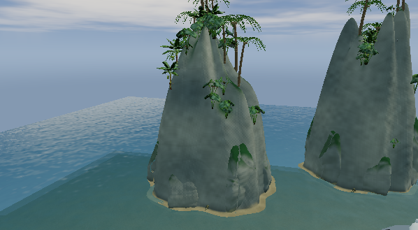
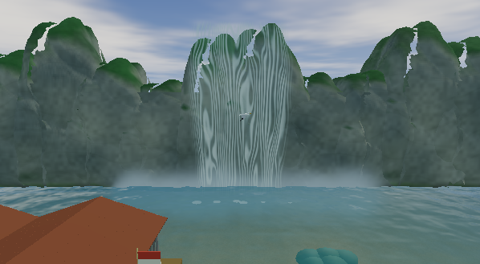
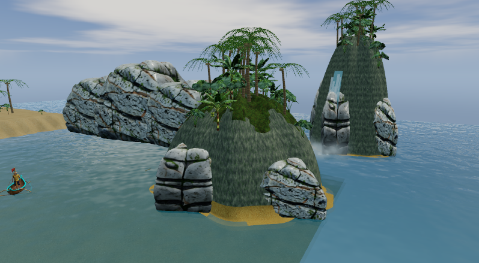
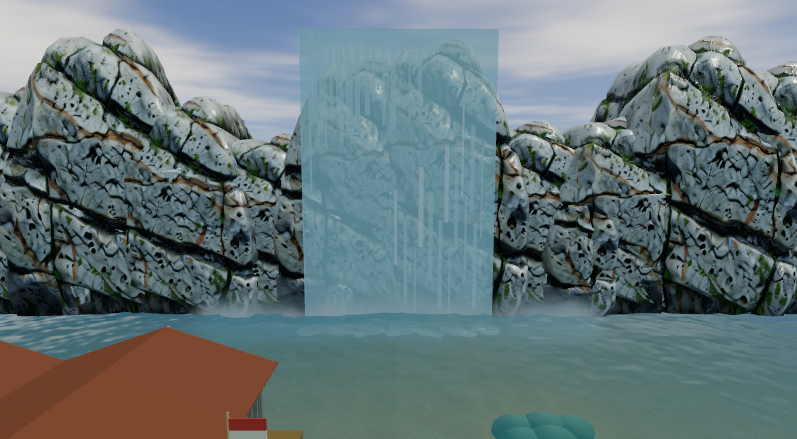
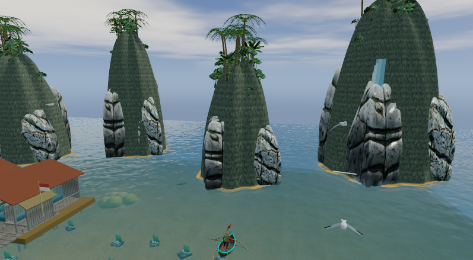
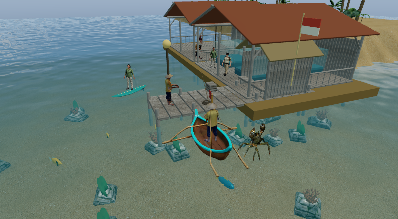

# Nusantara Fishing Madness 3D

**Dibuat oleh Ariana Mischa Fadhila dari Syubadubin Studios.**  
**Created by Ariana Mischa Fadhila of Syubadubin Studios.**

Petualangan memancing Indonesia dengan renderer 3D native, 14 lingkungan biome, eksplorasi darat/air, koleksi, boss regional, dan co-op otoritatif. Dibangun dengan .NET 10, Avalonia 12, ThreeNet, ReactiveUI, dan CommunityToolkit.Mvvm.

An Indonesian fishing adventure with authored biome layouts, living environments, local progression and server-owned online play. Windows gameplay and networking have been exercised locally. Public release still requires signing, cross-platform runtime validation and broader playtesting: see [PLAN.md](PLAN.md).



*Ilustrasi promosi Rodin / Rodin promotional concept art. Actual gameplay screenshots appear below.*

## Unduh installer / Download

[Release 0.3.0-preview.3](https://github.com/SyubadubinStudios/NusantaraFishingMadness/releases/tag/v0.3.0-preview.3) includes the .NET runtime:

| Platform | Installer |
|---|---|
| Windows x64 | [Setup EXE](https://github.com/SyubadubinStudios/NusantaraFishingMadness/releases/download/v0.3.0-preview.3/NusantaraFishingMadness-0.3.0-preview.3-win-x64-setup.exe) |
| Linux x64 (Ubuntu/Debian) | [DEB](https://github.com/SyubadubinStudios/NusantaraFishingMadness/releases/download/v0.3.0-preview.3/NusantaraFishingMadness-0.3.0-preview.3-linux-x64.deb) |
| macOS 15+ Apple Silicon | [ARM64 PKG](https://github.com/SyubadubinStudios/NusantaraFishingMadness/releases/download/v0.3.0-preview.3/NusantaraFishingMadness-0.3.0-preview.3-osx-arm64.pkg) |
| macOS 15+ Intel | [x64 PKG](https://github.com/SyubadubinStudios/NusantaraFishingMadness/releases/download/v0.3.0-preview.3/NusantaraFishingMadness-0.3.0-preview.3-osx-x64.pkg) |

Preview installers lack trusted publisher signatures; macOS uses an ad-hoc app signature without notarization. See [installation notes and limitations](docs/releases/v0.3.0-preview.3.md) and [SHA256SUMS](https://github.com/SyubadubinStudios/NusantaraFishingMadness/releases/download/v0.3.0-preview.3/SHA256SUMS). Native graphical gameplay has been exercised on Windows; CI installation checks do not establish Linux/macOS graphics compatibility.

## Jalankan / Run

Install .NET SDK 10.0.401 or a compatible .NET 10 feature band. Graphics require DirectX 12 (Windows), Vulkan (Linux), or Metal (macOS). Linux/macOS runtime behavior remains unverified. Blender and Rodin are unnecessary to play.

```sh
dotnet restore NusantaraFishingMadness.slnx --locked-mode
dotnet build NusantaraFishingMadness.slnx -c Release --no-restore
dotnet run --project src/NusantaraFishing.Desktop -c Release --no-build
dotnet test NusantaraFishingMadness.slnx -c Release --no-build
```

For integrated GPUs append `-- --low-power` to the run command. It disables shadows, uses one MSAA sample and renders at 60% scale. Initial GPU startup with the new art measured about 50 seconds on Intel UHD 620; see [performance](docs/performance/README.md).

Create a self-contained desktop/server package with `powershell -NoProfile -File tools/publish.ps1`. Run the packaged `NusantaraFishing.Desktop.exe`, or use `install.ps1`. The package includes .NET. See [installation and release checks](docs/release.md).

## Bermain / Play

| Default control | Action / Aksi |
|---|---|
| W A S D | Sail or walk / Berlayar atau berjalan |
| Drag, scroll | Orbit camera, zoom |
| Space | Cast; hold to reel / Lempar; tahan untuk menarik |
| A / D during fishing | Follow fish direction / Ikuti arah ikan |
| E / F / J | Board or disembark / ability / jump |
| Gamepad | Left stick move, right stick camera, A reel, B board, X ability, Y jump |

Release during attacks and high tension. Sell catches in **Koleksi**, claim quests in **Misi**, upgrade in **Bengkel**, and travel through **Peta nusantara**. **Pengaturan** offers English/Indonesian, remapping, audio, text scale, reduced motion and graphics. **Perairan** adjusts persistent water clarity/waves.

**Tentang / About** presents scrolling credits with pause/replay controls. Reduced-motion mode starts the credits paused. Rodin illustrations accompany launch and regional loading. The [press kit](docs/press-kit.md) includes the artwork and native UI captures.

## Fitur / Features

- Fourteen authored region layouts with streamed terrain, currents, depth ecology, bait affinities and reef/line hazards; 44 catalog catches (including two optional bosses) and 14 regional bosses.
- Eleven characters with distinct Rodin meshes, active abilities, on-foot traversal, Ojan tree climbing/hand catching, six boat tiers and 24 quests, including discovery-gated quests.
- Transparent depth-aware water/refraction, caustics, underwater fish/coral, boat wakes and rain ripples.
- Boats pitch and roll with the swell, leave V-shaped wakes and collide with piers, buildings, islands and other solid scenery by their full hull; jetskis, wildlife, hooked fish and bosses ripple the surface too. / Perahu bergoyang mengikuti gelombang, meninggalkan riak V, dan tidak bisa menembus dermaga, bangunan, pulau atau benda padat lain.
- Living islands: forested limestone hills, wind-blown palms, banana plants and wild undergrowth, macaques, monitor lizards, villagers and cascades with mist. / Pulau hidup: bukit kapur berhutan, tumbuhan bergoyang ditiup angin, monyet, biawak, warga dan air terjun berkabut.
- Sunrise/noon/sunset/night, moving clouds, stars, fog, storms, lightning and harbor lights; boats, surfers, jetskis, drifters, working residents, visitors, birds and regional wildlife.
- Fourteen original synthesized regional music loops, boss/DJ themes with crossfades, ambience/effects, analytic environment lighting, Rodin jukung and Blender-rigged tuna.
- Rodin PBR human/karst meshes with Blender rigs and blended idle/walk/fishing clips; detailed timber harbor, coconut fronds, jetski, surfboard, gulls, dolphins and coral. See the [visual upgrade](docs/visual-upgrade.md) for scope and measured costs.
- Walkable museum/aquarium, exhibit placement, building upgrades and active-session visitor income; validated v2 saves migrate v1 progress.
- Raja Ampat snorkeling/spearfishing, Rina barter, Bambang research, Tono government-pier access, regional raft houses and persistent tournament trophies. All 58 catch/boss entries have exported models; 33 share ten Rodin anatomy sources. See [design alignment](docs/design-alignment.md) for remaining fidelity gaps.
- Four-player authoritative co-op, shared boss HP/rewards, reconnect, separate online economy, 32-slot festivals, UTC tournaments and leaderboards. Ambient actors follow scripted routines; drifters do not provide rescue missions.


| Pulau hidup / Living islands | Air terjun / Waterfall |
|---|---|
|  |  |
|  |  |
|  |  |

*Native captures from `--nature-review` on Intel UHD 620. / Tangkapan native dari `--nature-review`.*

## Development and documentation

`src/NusantaraFishing.Core` contains independent rules; `Desktop` contains Avalonia/ThreeNet rendering; `Server` contains HTTP hosting. Tests live in `tests/`; acceptance/packaging tools in `tools/`; runtime assets and editable sources in `assets/`.

Install Git LFS and run `git lfs pull` after cloning; GLB and Blender source files use LFS. For build-only checkouts, `git lfs pull --include="assets/models/**" --exclude=""` fetches only runtime models. Local `.mcp.json`, provider histories and credentials are excluded from Git. Project code uses the repository [MIT license](LICENSE); generated asset provenance is documented separately.

```sh
dotnet run --project tools/NusantaraFishing.Acceptance -c Release --no-build -- --delay-ms 100
dotnet run --project src/NusantaraFishing.Desktop -c Release --no-build -- --world-tour
dotnet run --project src/NusantaraFishing.Desktop -c Release --no-build -- --native-network-test
```

GPU commands require an interactive desktop; validation modes use isolated profiles. Read the [English guide](docs/en/guide.md), [panduan Indonesia](docs/id/guide.md), [networking](docs/networking.md), [architecture](docs/architecture.md), [assets](assets/README.md), [license inventory](docs/THIRD-PARTY-NOTICES.md) and [validation record](Progress.md).
