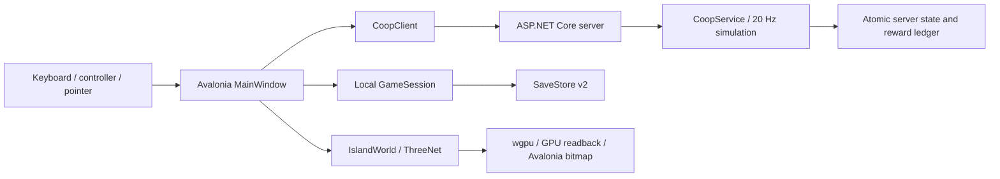

# Architecture / Arsitektur

## Module boundaries

**ID:** Core bebas dependensi GPU/UI. Desktop menggunakan GameSession lokal atau snapshot server; keduanya tidak berjalan bersamaan untuk progres yang sama. Server hanya menerima input dan aksi, bukan impor kekayaan lokal.

**EN:** Core owns catalog, weighted ecology, fishing state transitions, boss phases, traversal, economy, quests, exhibitions, progression and validated persistence. Desktop owns presentation, native rendering, preferences, localization, audio and input. Server serializes authoritative actions under one simulation lock and persists profiles, command sequences, tournament scores and encounter reward ledgers.

## World and rendering

Fourteen authored landmark layouts define coast, reef, river, city, lakes, caves, mines, crystals, volcanic and endgame environments. TerrainStreamer bounds residency to 49 tiles; geometry is released when tiles leave the neighborhood. A shared biome depth function informs navigability, ecology and optical depth.

IslandWorld partials separate landmarks/atmosphere, characters, exhibitions, ambient life, peers and batching. Static prop instances share geometry/materials. Actor movement is scripted region-specific ambient behavior. Remote peers interpolate server poses; parked remote boats retain independent positions when their owners walk ashore.

WaterSurface combines a CPU wave field with ThreeNet water shading: depth-aware absorption, limited transmission refraction, reflection, caustics and wakes. Original RGBE environment source is encoded at fixed exposure for runtime filtering compatibility. Sunlight, fog, clouds, stars, lamps, precipitation and synthesized audio follow simulation conditions.

**Hull collision.** Core owns boat solidity so local play and the authoritative server agree. `BoatHull` gives each boat tier its half length/width (outriggers included), and `PlayerState.BoatHeading` stores the bow yaw, replicated in `PeerView`. `WorldDefinition.HullFits` tests circles from midships to the bow against each landmark's rendered waterline footprint (`Landmark.BlocksSailing`: island ellipses, cliff block overhangs, asymmetric raft houses, crystals, vents, signs, waterfalls) plus the harbor pavilions and fishing pier. The stern is deliberately excluded so a boat pressed against a wall can always turn away; a turn that would push the bow into scenery is refused, and hulls left overlapping by older saves may motor out under the previous point rule. Bridges, arches, clouds and submerged reefs stay passable. `Landmark.IslandSurface` is the single island height field used by rendering, vegetation, wildlife and on-foot climbing.

**Water feel.** `WaterMotion.cs` holds `WakeTrail` and `FloatingBody`. Wakes are emitted per distance travelled (bow lift plus alternating stern dents, forming a V), never per frame, so they are frame-rate independent; teleports reset the trail. Hull motion samples an analytic swell plus the simulated ripple field at bow, stern and both beams, then smooths pitch, roll and heave. Only a fraction of swell heave is applied because the GPU surface shades but does not displace the swell. Amplitude follows the wave setting, weather and basin, and drops to 20% under reduced motion. The player's boat, remote peers and ambient craft share these types.

**Wind and life.** Vegetation registered with `Sway` (palms, banana plants, undergrowth, rainforest trees, seagrass) is excluded from static batching and grouped into per-geometry instance batches. Each frame recomputes instance matrices as a bend about each plant's base point from a wind direction, gusts and weather strength; underwater seagrass ignores wind. Island cascades follow the hill surface as a path; foam ribbons, churning plunge foam, pool ripples and a CPU `ParticleEffect` mist animate along it. Wildlife (rigged macaques, monitor lizards reusing the catch model) and villagers follow deterministic time-based routes, so no per-frame allocation or random state is needed.

An 8 ms UI tick schedules simulation and start-to-start rendering deadlines; view-owned automatic rendering is disabled. The legacy timer path remains behind a benchmark flag. Rendering reads GPU pixels into Avalonia bitmaps, so measured FPS includes transfer and scheduling costs.

ThreeNet 0.12 caches GPU resources using scene-local IDs. `SceneCacheCompatibility` renders an empty scene before replacement to prune geometry/textures/materials and reset environment bindings. It advances instance edit versions for reused node IDs; water shader versions distinguish authored regions. This avoids stale cross-region meshes without recreating the GPU device. Remove this adapter only after an upstream scene-aware cache fix is verified. Runtime simplified geometry is shared by tiny submerged rocks and boat hulls; full source models remain available.

**ID:** Tabrakan lambung perahu dihitung di Core agar mode lokal dan server otoritatif selalu sama. Riak dipancarkan berdasarkan jarak tempuh, bukan per frame. Goyangan lambung mengikuti alun analitik dan riak simulasi. Tumbuhan bergoyang melalui batch instance yang matriksnya diperbarui setiap frame.

## State and services

Local v2 saves migrate v1, validate ranges/catalog references and replace atomically. They include position/boat position, bait, exhibit placements, upgrades, regional progress and cooldown. Active fights are transient. Invalid saves remain untouched; autosave is disabled until recovery. Preferences and reconnect identities use separate local files. Online sessions restore the prior local snapshot on disconnect.

CoopService runs at 20 Hz with stale-input expiration, ordered commands, shared encounter phases and server-side scoring. SHA-256 token hashes are stored server-side. Persistence uses atomic replacement; the server host holds an exclusive data-directory lock. HTTP request/identity limits constrain abuse but do not replace a public authentication/moderation service.

Crash reporting is local-only and opt-in. Audio/device initialization is optional so a missing sound device does not prevent gameplay. Native graphics incompatibility is shown in the application.

## Validation boundaries

Core xUnit tests cover rules, saves, traversal and authoritative service behavior. The HTTP harness launches a real server and four clients. Native smoke modes exercise GPU worlds, water, settings, audio and network avatars. Cross-platform CI defines build/unit/HTTP jobs; interactive graphics and release signing need external runners/credentials. See [release status](release.md).
