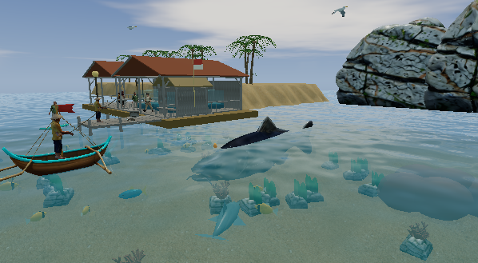
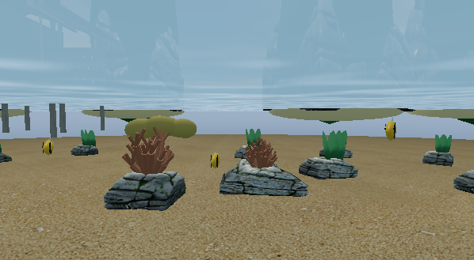
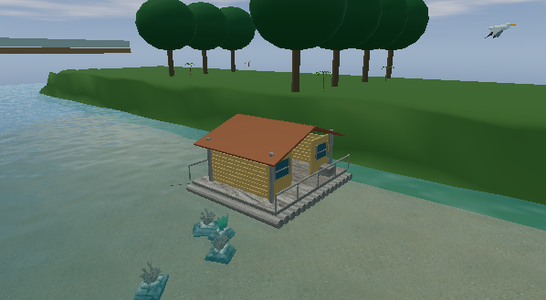

# Design alignment / Kesesuaian desain

Checkpoint: 16 October 2026. Basis: `solution-design.md` and `NusantaraFishingMadness.txt`. Created by Ariana Mischa Fadhila, Syubadubin Studios.

## Implemented / Sudah diterapkan

| Area | Implementation / Implementasi |
|---|---|
| Characters | Eleven distinct Rodin meshes: Ujang, Rina, Bambang, Tono, Ojan and six unlockable characters. Blender sixteen-bone rigs with Idle, Walk and Fishing clips. |
| Catch objects and rulers | All 44 catalog entries and fourteen regional bosses have GLBs used in encounters and exhibitions. Ten Rodin anatomy sources supply 33 variants; 25 exports use original procedural geometry. |
| New encounters | Ikan Naga Situ Patenggang, Lele Penunggu Kubangan, Paus Kubangan, Hiu Karang Selatan and Ikan Terbang. The final whale requires three endgame regional victories. |
| Creature behavior | Octopus camouflage/ink, Phantom visibility, Ninja reflex response, crab counter window, rocket squid dash, electric eel and crocodile attack windows. Batik/Disco colors animate; elongated Rodin creatures have four-bone Swim clips. |
| Character mechanics | Rina barter (3 sandals for keris; 2 fridges for map), Bambang research, Tono government-pier permission, Ojan tree climbing/jumping and shore hand catching. |
| Underwater play | Raja Ampat snorkeling records/releases conservation wildlife; spear mode excludes protected species. Swimming leaves the boat moored and uses an underwater camera. |
| Kraken party | At least two ready online players must be in Raja Ampat in the same room. Both must challenge the boss; fighting pauses if fewer than two participants remain connected, while the three-minute deadline continues. |
| Progression | 24 quests, discovery-gated secret quests, Dugong achievement, persistent top-three tournament trophies displayed in the museum. |
| Locations | Fourteen biome layouts, Kalimantan raft houses, government outposts/guards in Jakarta and the quarry, actual catch models in exhibitions. |
| Sound | Fourteen synthesized regional loops plus boss and DJ themes, crossfades, volume/mute and existing environmental effects. |

**ID:** Model seluruh entri katalog sudah tersedia, tetapi cakupan katalog tidak berarti seluruh detail desain selesai. Varian boss masih berbagi anatomi dasar. Nama Situ Patenggang belum menjadi lokasi baru tersendiri. Musik sudah diputar oleh game; aransemen masih berupa loop sintetis asli proyek.

## Remaining fidelity work / Detail yang belum selesai

- Twenty-five catch exports retain stylized procedural forms. Several boats and scenery pieces need a comparable detailed art pass. Regional buildings and vegetation still share assets.
- Character rigs need closer animation review, especially coats/aprons and nonhuman silhouettes. Rodin octopus/squid limbs do not yet have individual skeletal animation.
- Snorkeling and spearfishing currently reuse directional encounter controls; a dedicated approach/aim/throw interaction remains to be developed.
- Boss combat still shares regional attack archetypes; further distinct combat patterns remain to be developed. Kraken now enforces a multi-player party requirement.
- Ambient NPCs have scripted activities; drifters have no rescue quest. This pass does not supply deeper social AI or every bespoke interaction described in the design.
- Startup time, wider hardware coverage, physical controllers, 32 rendered festival clients, Linux/macOS runtime tests and independent playtesting remain open. Distribution requirements remain in [PLAN.md](../PLAN.md).

**ID:** Tahap berikutnya mencakup pemolesan animasi, aset yang masih sederhana, interaksi menyelam/tombak, pola boss khusus, aktivitas NPC, serta pengujian performa. Jangan menandai seluruh desain atau rilis produksi selesai berdasarkan keberadaan aset saja.

## Reproduce verification / Ulangi pengujian

```sh
dotnet test NusantaraFishingMadness.slnx -c Release
python tools/validate-visual-assets.py
python tools/audit-assets.py
dotnet run --project tools/NusantaraFishing.Acceptance -c Release -- --delay-ms 100
dotnet run --project src/NusantaraFishing.Desktop -c Release -- --screenshot --content-review --world-tour --low-power
```

The native content review loads every character and catch model, exercises underwater entry, music transitions, museum trophies and Tono access. It captures frames and checks renderer errors; visual realism still requires inspection. Evidence: `docs/validation/design-runtime.json`, `visual-assets.json`, `network.json` and `docs/images/design-*.png`.






