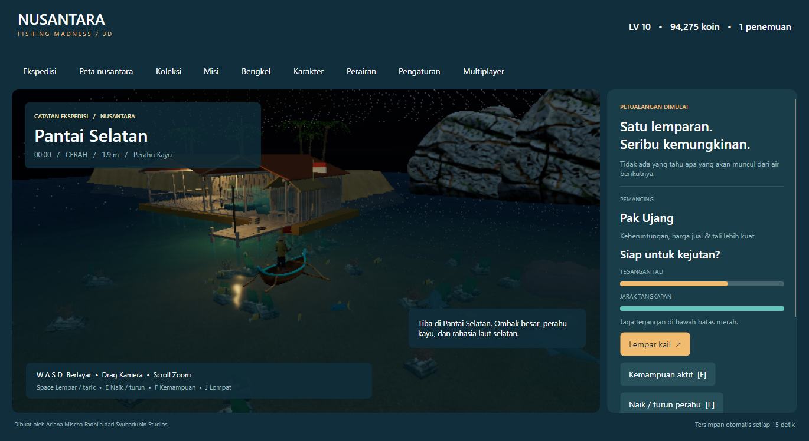

# Player guide

Created by Ariana Mischa Fadhila of Syubadubin Studios.

## Start and explore

Run the Windows self-contained package or follow the .NET 10 commands in [README](../../README.md). First GPU initialization can take around 50 seconds on Intel UHD 620. Try `--low-power` on integrated GPUs. Windows has been exercised locally; Linux/macOS need runtime validation.

Choose a character in **Karakter**; six secret profiles unlock with level progression. WASD sails/walks; drag rotates the camera; scroll zooms. E boards/disembarks near your boat, dock or shore. J jumps; F activates a 12-second ability with a 60-second cooldown. Ojan and Pendaki traverse steeper banks.

## Fish and progress

Space casts while idle. After a bite hold Space to reel; release to reduce tension. Follow fish direction with A/D. Reef contact stresses the line: change direction and release. Bait, depth, weather, region and nighttime alter catch probabilities.

Sell in **Koleksi**, claim ten general/fourteen regional quests in **Misi**, upgrade in **Bengkel**, and unlock regions through the atlas. There are 44 catalog catches plus fourteen regional bosses. Conservation encounters are recorded and released automatically. Bosses require rod level 3 and ten catches: respect attack warnings and reel during recovery.

**Kraken Raja Ampat requires a party.** Join the same online room with at least one partner, travel to Raja Ampat, and return to your boats. Both players need a level 3 rod, ten catches, inventory space and bait money. Each selects **Challenge regional boss**. Combat waits until two participants have joined and pauses if fewer than two remain connected; the three-minute encounter deadline keeps running. Idle connections time out after 30 seconds. Reconnect with your saved identity to resume. Solo regional bosses elsewhere remain available.

Donate species, place exhibits and improve aquarium/museum buildings. Visit their displays on foot. Income accrues only during active simulation.

In Raja Ampat, select **Catching method** to enter snorkeling or spear mode from a boat. WASD swims; hold Reel and follow A/D during encounters. Snorkeling records and releases wildlife; spear mode excludes conservation species. Return within four metres of the moored boat to select the rod again. These modes consume no bait.

Ojan can catch by hand while standing at a reachable shoreline. Approach a tree and choose climb/descend; J jumps down. Rina can barter three sandals for a keris or two fridges for a secret map. Bambang's research reports current conditions. Tono can land at government outposts in Jakarta and the quarry. Discovery opens secret quests; Paus Kubangan requires the mountain, crystal and dimension bosses to be defeated. Top-three tournament prizes include persistent museum trophies.

Each region has its own music loop. Boss and DJ encounters crossfade to dedicated themes; the regional track resumes afterward. Adjust music volume in Settings.

## Water, atmosphere and settings

**Perairan** saves clarity/wave preferences. Transparent water reveals depth, fish, rocks, coral and seagrass. Moving boats leave a V-shaped wake; jetskis, surfers, crocodiles, surfacing dolphins, monitor lizards, hooked fish and bosses ripple the surface too, as do rain, casts, bites and waterfalls. Hulls pitch and roll with the swell: the wave setting, storms and open sea make them rock harder, lakes and rivers less, and reduced motion keeps them nearly level. Your boat's hull collides with piers, buildings, islands, crystals, vents, signs and waterfalls; it can still pass beneath bridges and arches and over submerged reefs. Steer away from a wall to turn free.

Islands are forested hills with limestone cliffs and beaches. Palms, banana plants and wild undergrowth bend in the wind (harder in rain and storms). Macaques forage on island crowns and banks, monitor lizards bask on beaches and swim offshore, and villagers stroll the banks by day. The twelve-minute day cycle includes morning/noon/sunset/night. Weather changes every 75 simulation seconds. Ambient boats, jetskis, surfers, drifters, residents and wildlife follow regional routines; they are not rescue missions.

**Pengaturan** controls language, text size, reduced motion, shadows, resolution/FPS, audio and keyboard bindings. Gamepad: left stick move, right stick camera, A cast/reel, B board, X ability, Y jump, bumpers zoom. Native virtual controller input passed validation; physical devices need broader testing.

## Multiplayer and saves

Open **Multiplayer** and host locally or enter a server URL. Co-op allows four players; festivals have 32 connection slots. Online progress is separate and owned by the server. Stored identities reconnect to the same room. Shared bosses expire after three minutes and reward positive contributors once. UTC daily/weekly/quarterly boards pay prizes after a period ends. See [networking](../networking.md).

Data lives in `<LocalApplicationData>/SyubadubinStudios/NusantaraFishingMadness/`: `save.json`, `settings.json`, `server-identities.json` and `server/`. Save occurs every 15 seconds/on close; v1 migrates to v2. Active fights do not resume. Invalid saves are preserved with autosave disabled. Back up data; keep identity credentials private.

Opt-in crash reports stay in `crash-reports/`; nothing uploads automatically. See [release checks](../release.md) for remaining validation.

