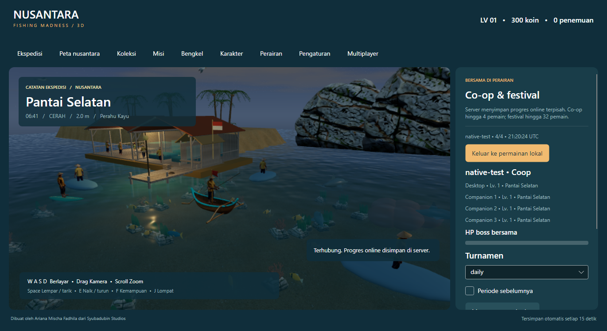

# Multiplayer / Jaringan

## Host and join / Host dan gabung

**ID:** Di aplikasi pilih **Multiplayer**, isi nama dan ruang, lalu **Host lokal & gabung**. Server bawaan memakai `http://127.0.0.1:5077` dan berhenti ketika aplikasi host ditutup. Untuk LAN jalankan server terpisah dengan alamat jaringan, lalu klien memasukkan IP host dan nama ruang yang sama. Mode ruang tidak dapat diganti setelah dibuat.

**EN:** Use **Multiplayer** to host locally or join a server. The bundled local host runs until the desktop closes. For LAN play, launch the server explicitly and enter its LAN IP on other clients. Co-op rooms allow four clients; festival rooms allow 32. These are room capacities; 32 simultaneously rendered desktop clients have not been load-tested.

```sh
dotnet run --project src/NusantaraFishing.Server -c Release --no-launch-profile -- --urls http://0.0.0.0:5077 --DataDirectory ./artifacts/lan-server
```

Packaged equivalent: `server/NusantaraFishing.Server.exe --urls http://0.0.0.0:5077 --DataDirectory <directory>`. `stop` on stdin or Ctrl+C shuts down gracefully. Allow the port through the host firewall only for the intended network. One server process owns a data directory; concurrent ownership is rejected.

## Authority and persistence / Otoritas dan persistensi

Server simulation runs at 20 Hz. Clients submit movement/reel inputs at approximately 10 Hz and ordered gameplay actions. The server controls fishing, movement, inventory, coins, quests and rewards. Local saves cannot be imported. Online identities are stored privately in the client's `server-identities.json`; the server stores token hashes. Losing that client file loses automatic reconnect access to its profiles.

State is atomically persisted every five seconds and after reward/action changes. The default location is `<LocalApplicationData>/SyubadubinStudios/NusantaraFishingMadness/server/server-state.json`; override with `--DataDirectory` or `NFM_DATA_DIRECTORY`. Back up while stopped. Protocol version 2 rejects incompatible clients. Monotonic command sequences reject replays; stale input stops after two seconds; inactive peers expire after thirty seconds.

Protocol 2 replicates swimming, climbing and jump height. Catching-method selection, barter and climbing are server-validated commands. Catching methods cannot change during a shared boss encounter. Top-three ended-period prizes also grant a persistent museum trophy; repeated claims do not duplicate it.

Shared boss HP scales with active party size and later participants. Positive damage contributions earn one reward per encounter; reconnect/restart preserves the reward ledger. A shared encounter clock controls telegraphs and expires at 180 seconds. Daily, ISO-weekly and quarterly tournament boundaries use UTC; prizes for ended periods can be claimed once.

## Verification and deployment / Verifikasi dan deployment

```sh
dotnet run --project tools/NusantaraFishing.Acceptance -c Release --no-build -- --delay-ms 100
dotnet run --project src/NusantaraFishing.Desktop -c Release --no-build -- --native-network-test
```

The first command exercises four independent HTTP connections, fishing, injected response latency, reconnect, server restart, economy isolation and duplicate prevention. The second verifies native avatars, routed keyboard input and a virtual gamepad. Test fixtures use isolated data directories.

Transport is HTTP request/response, with bearer tokens in authorization headers. Use a trusted LAN or terminate HTTPS at a reverse proxy for remote deployment. Built-in limits include 16 KB requests, 128 concurrent connections, 40 requests/second per identity, join throttling and a 1,024-profile ceiling. There is no production account recovery, hosted matchmaking, moderation console or cloud infrastructure. Configure those separately before offering a public service.


