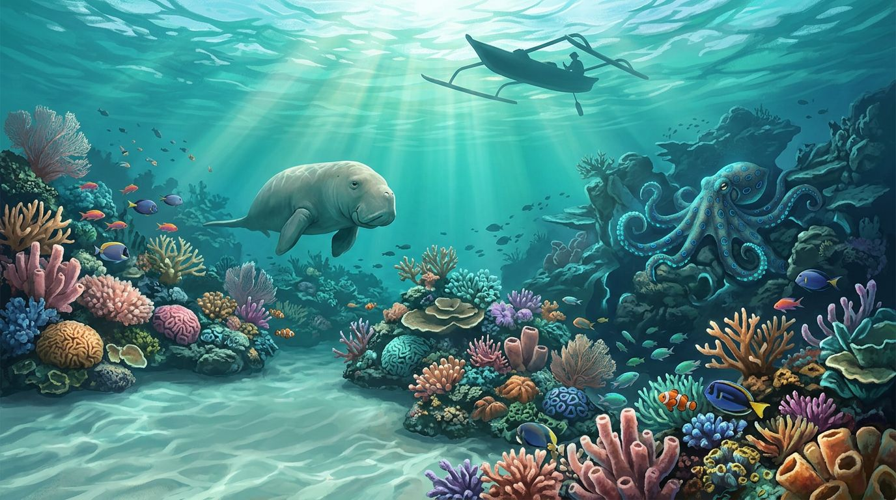
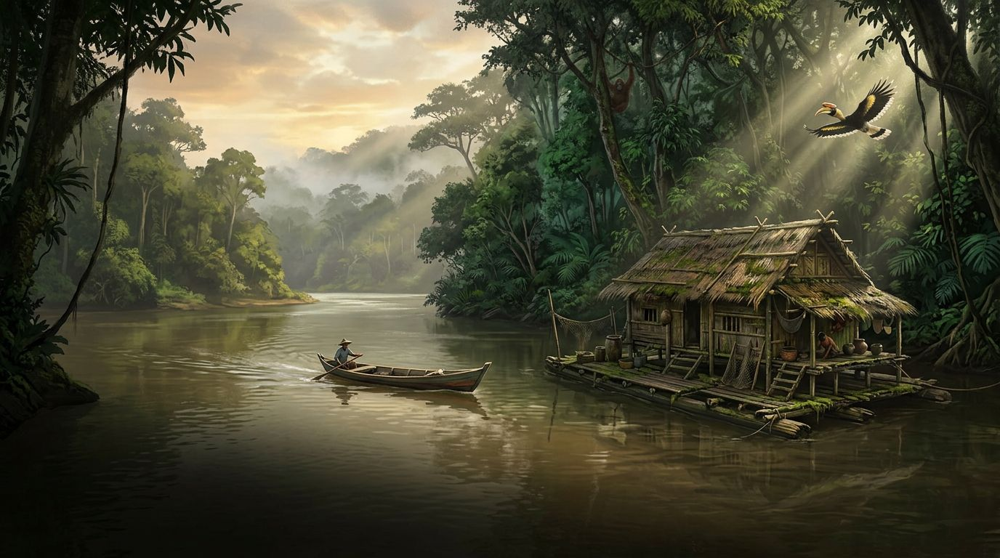
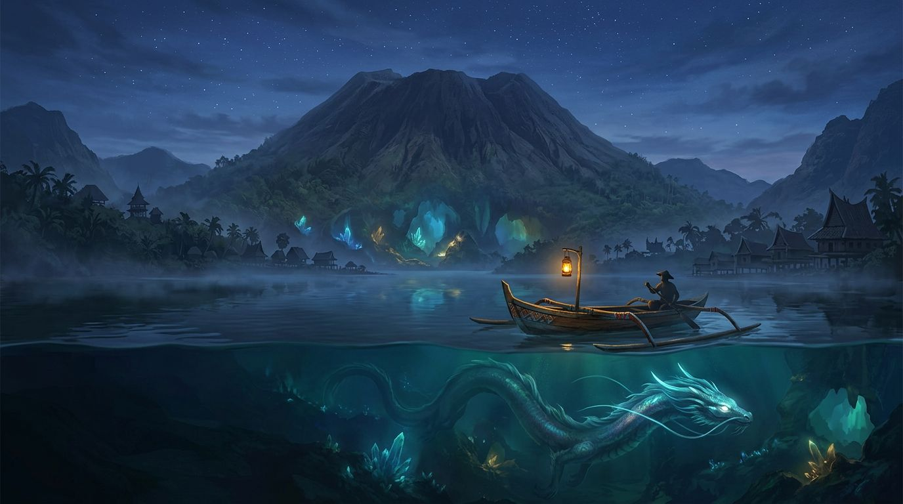
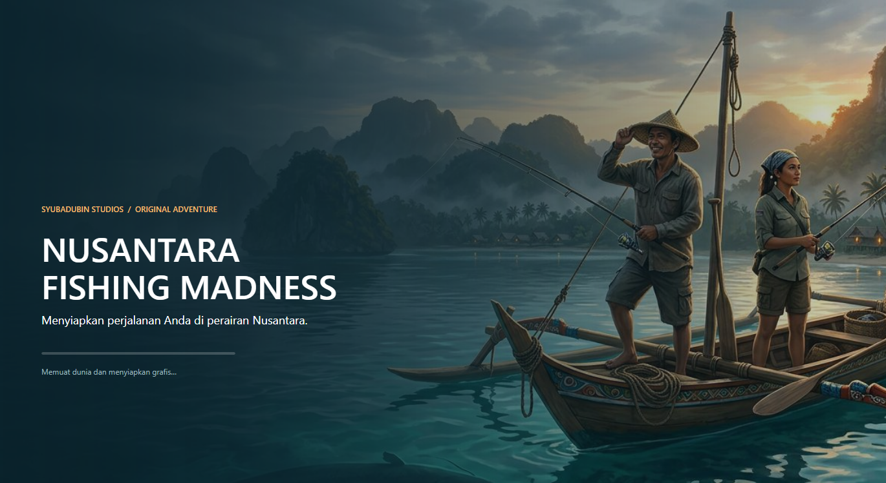
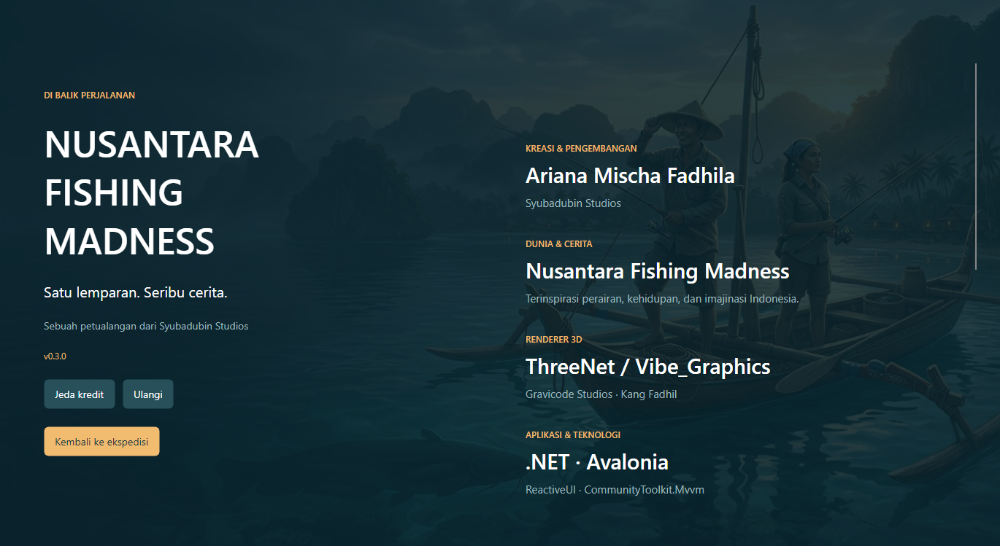

# Press kit / Materi publikasi

**Nusantara Fishing Madness 3D** — an Indonesian fishing adventure by **Ariana Mischa Fadhila, Syubadubin Studios**.

**ID:** Jelajahi perairan Nusantara, temukan tangkapan tak terduga, dan hadapi legenda bersama teman. Materi di bawah tersedia untuk dokumentasi dan publikasi proyek. Ilustrasi konsep dibedakan dari screenshot game agar tidak menyamakan kualitas ilustrasi dengan render runtime.

**EN:** Explore Indonesian waters, discover unexpected catches, and face local legends with friends. The illustrations below are promotional concept art, not gameplay screenshots. Preserve the creator/studio attribution and the recorded Rodin asset provenance when using these materials.

## Key art / Ilustrasi utama

`launch-voyage.jpg`: launch screen, README and editorial cover. Subjects sit to the right to leave space for live typography. No text is baked into the image.

## Regional illustrations / Ilustrasi wilayah

Reef/coastal loading illustration: Raja Ampat, dugong, coral and octopus.

River loading illustration: raft house, rainforest, traditional boat and hornbill.

Mythical loading illustration: volcanic lake, crystals and legendary dragon.

## Native UI captures / Tampilan aplikasi

The About page supports scrolling, pause, replay, manual scrolling and reduced motion. **ID:** Halaman Tentang menyediakan kredit otomatis, jeda, pengulangan dan pengaturan pengurangan gerak.

## Sources / Sumber

All five original illustrations/icon were generated through **Rodin MCP, GenerateImageWithNanoBanana2**. Exact prompts live in `assets/sources/rodin-launch-voyage.json`, `rodin-loading-reef.json`, `rodin-loading-river.json`, `rodin-loading-myth.json` and `rodin-game-icon.json`. The icon's PNG/ICO/ICNS formats are conversions of the same generated image. No stock photo or third-party soundtrack was added for this presentation pass. See [asset provenance](../assets/README.md).
