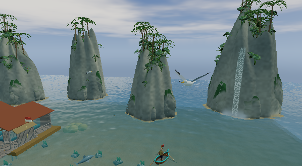
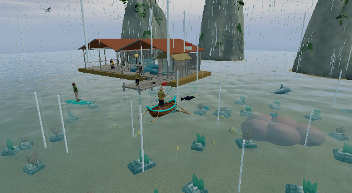

# Environmental rain / Hujan lingkungan

Created by Ariana Mischa Fadhila, Syubadubin Studios.

Rain previously used 110 drops in a 40 m square attached to the moored boat. The drop size was applied as a node scale, which also scaled each instance offset and collapsed the particles into a column near the origin. Rain therefore appeared local to the player instead of covering nearby landmarks and water.

The renderer now uses separate near and distant instance layers (2,700 drops total) centered on the active play area. Drop scale is stored in each instance matrix, leaving world-space offsets intact. Rain and storms also raise the water simulation's rain rate; underground regions suppress outdoor precipitation.

**Validation:** `dotnet build NusantaraFishingMadness.slnx -c Release --no-restore` completed with zero warnings/errors; all 68 tests passed. Native Windows Raja Ampat review logged `RAIN_RENDER_OK: region=ampat, drops=2700, near/far enabled, rate=18` and completed `NATURE_DIRECT_OK` / `SMOKE_OK`. The same-angle captures show the change:

| Clear weather | Rain |
|---|---|
|  |  |

**ID:** Sebelumnya hanya ada 110 tetes di area 40 meter di sekitar perahu. Skala node ikut mengecilkan offset semua tetes, sehingga hujan menumpuk di dekat origin dan tampak hanya di sekitar pemain. Renderer kini memakai dua lapisan berisi 2.700 instance, dengan ukuran per tetes terpisah dari posisi dunia. Riak hujan turut memengaruhi permukaan air; cuaca hujan luar ruang dimatikan di wilayah bawah tanah.

**Uji:** Build Release tanpa warning/error, 68 tes lulus, dan review native Raja Ampat menghasilkan log `RAIN_RENDER_OK` serta capture pada sudut kamera yang sama dalam cuaca cerah dan hujan.
