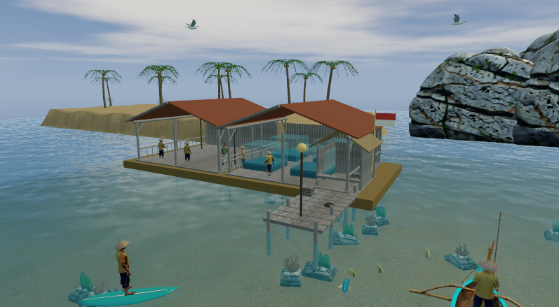
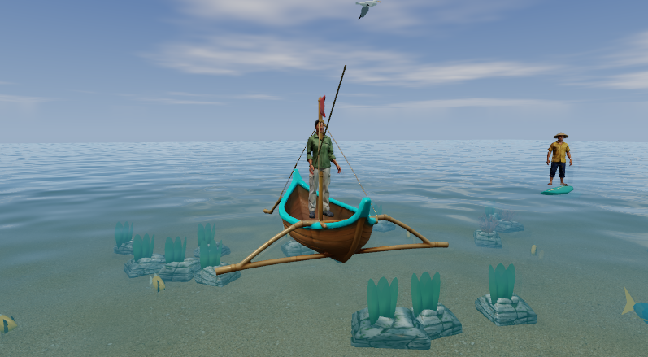

# Visual upgrade / Peningkatan visual

Created by Ariana Mischa Fadhila, Syubadubin Studios.

## Current scope / Cakupan terbaru

The original two-character art pass described below is superseded by the [design alignment pass](design-alignment.md): eleven distinct character meshes, 58 catch/boss exports, raft houses, government outposts, trophies and regional music. The current inventory contains 116 runtime files (84 GLBs); 33 catch variants share ten Rodin anatomy sources. Earlier measurements and package references below remain historical evidence, not measurements of the expanded content.

## Original pass / Tahap awal

**ID:** Rodin MCP menghasilkan model PBR pemancing pria, Rina dan batu karst, tekstur pasir/kayu, serta ilustrasi pelabuhan. Blender MCP digunakan untuk optimasi mesh, rig 16 tulang, skin weights, dan tiga loop animasi: Idle, Walk, Fishing. Karakter manusia dan warga memakai rig tersebut; profil khusus robot, kucing, serta orangutan tetap memiliki bentuk tersendiri.

**EN:** Rodin MCP generated the fisherman, Rina and karst PBR meshes, sand/teak textures and harbor illustration. Blender MCP prepared 7,000-triangle character meshes, sixteen-bone skeletons, skin weights and three animation loops. Runtime blends movement/fishing poses, offsets resident animation phases, and attaches the player's rod to the animated hand. At that earlier checkpoint, character profiles reused two detailed human base meshes. The current eleven-mesh scope is documented above; photorealistic production quality is not claimed.

Blender-authored assets include coconut palms with individual leaflets, a timber fishing pier, open exhibition pavilions, fishing crates/rope, jetski, surfboard, articulated gull wings, dolphin tail, branching coral and reef fish. Static imported scenery shares resources and joins instance batches. Character skeletons remain independent.

**ID:** Garis pantai memiliki lereng dan pasir bertekstur. Karst disusun dalam kelompok. Air tetap transparan, dengan detail riak yang melemah di kejauhan, refleksi lebih halus, caustics, serta dasar laut yang terlihat. Langit memakai awan prosedural bersama siklus waktu/cuaca yang sudah ada. Ilustrasi 2D dipakai pada atlas perjalanan.

**EN:** Sloped textured shores, grouped karst, underwater rocks/coral and a lower camera angle improve the environment. Water retains depth-aware transparency and wakes while reducing distant ripple aliasing. Procedural clouds replace opaque decorative cloud discs in ordinary regions; sky-biome landmarks remain distinct.

## Source and validation / Sumber dan pemeriksaan

- `assets/sources/rodin-*.json`: exact generation prompts; `sources/rodin/*.glb`: unmodified generated bases.
- `assets/sources/build-visual-assets.py`: reproducible Blender preparation and original geometry; `visual-library.blend`: twelve isolated authoring scenes.
- Runtime exports: `assets/models`, `assets/textures`, `assets/art`. Blender and Rodin are not runtime dependencies.
- `python tools/validate-visual-assets.py`: isolated GLB scenes, embedded textures, triangle limits, animation names and normalized skin weights. Raw report: [visual-assets.json](validation/visual-assets.json).
- `dotnet run --project src/NusantaraFishing.Desktop -c Release -- --world-tour --visual-review`: native regions, character switching and review captures using an isolated save.

The completed second tour visited all fourteen regions and returned to the coast for sunrise/noon/sunset/night captures. This exposed and then verified the fix for cross-scene resource ID reuse in ThreeNet 0.12; details are in [architecture](architecture.md). The first tour's lack of crashes was not treated as sufficient visual evidence.

This is a substantial art pass, not a claim of fully photorealistic production art. Special characters, bosses and some regional props still use simpler authored forms. See [performance measurements](performance/README.md) for hardware limits and [asset provenance](../assets/README.md) for provider attribution.
